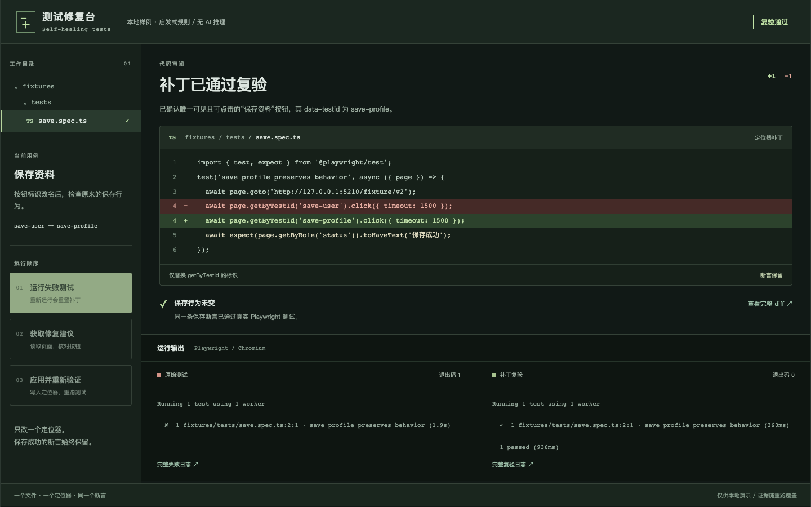
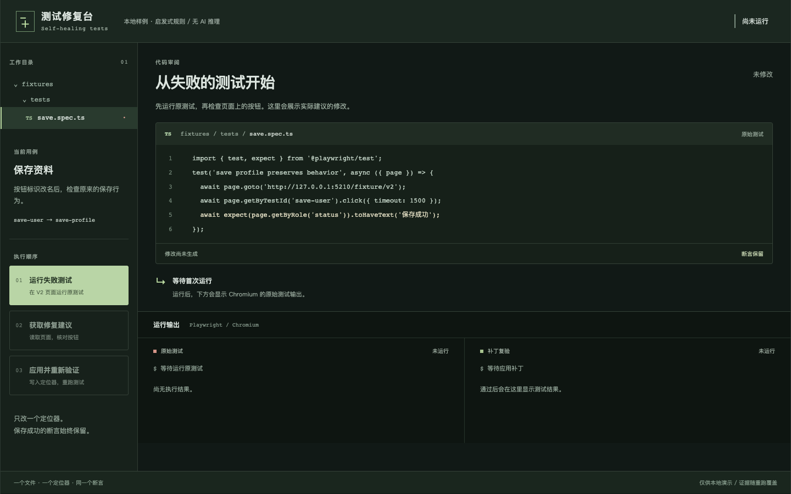

# 测试修复台

按钮的 `data-testid` 改了，保存功能没坏，测试却失败了。这个本地工作台把失败日志、定位器补丁和重新运行的结果放在一起，让你看清楚究竟改了什么。



适合写 Playwright 测试的开发者，用一个小例子讨论自动修复的边界：可以修定位器，但不能为了通过测试而修改断言。这里没有调用大模型；建议来自针对样例页面的规则，浏览器执行、文件修改和测试输出都是真实的。

## 在本机启动

需要 Node.js **^22.12.0 || ^24 || >=26** 和 npm。首次安装需要网络下载依赖与 Chromium；不需要 API Key、Python 或云服务。

在本项目目录运行：

```sh
npm run setup
npm run doctor
npm run dev
```

打开 **http://127.0.0.1:4210**。网页和 API 分别使用 4210、5210 端口，只监听本机。`doctor` 会实际启动浏览器、录制一小段视频并检查端口，因此要在启动开发服务前运行。

`setup` 执行 `npm ci --cache .npm-cache`，然后把 Playwright Chromium 安装到项目的 `.browsers/`。依赖由锁文件固定，不修改全局配置。Linux 缺少系统库时，按 doctor 报错补齐系统依赖；脚本不会替你安装系统软件。

已经安装依赖和 Playwright 浏览器时，可以先运行 `npm run doctor`。程序依次查找显式路径、项目 `.browsers/`、系统标准 Playwright 缓存，已有浏览器只读复用。FFmpeg 必须匹配当前 Playwright 版本。需要手动指定时，在终端设置 `PLAYWRIGHT_EXECUTABLE_PATH` 或 `PLAYWRIGHT_BROWSERS_PATH`；`.env.example` 仅提供说明，不会自动加载。

## 试一次定位器修复

样例中的 V2 页面把按钮标识从 `save-user` 改为 `save-profile`，测试还使用旧标识。

1. 点击 **运行失败测试**。Chromium 打开 V2，旧定位器超时；左下方出现真实失败输出。
2. 点击 **获取修复建议**。程序检查页面中“保存资料”按钮是否唯一、可见、可操作。中央源码显示第 4 行的删除与新增。
3. 审阅差异后，点击 **应用并重新验证**。程序修改 `fixtures/tests/save.spec.ts`，再次运行测试。只有退出码为 0，才显示“复验通过”。

首图是实际复验结果：红绿差异只有一行，紧接着的 `toHaveText('保存成功')` 没有变。下面是运行前的工作台，源码与输出区等待第一次执行。



再点第一步会恢复原测试并重新开始。运行时操作按钮禁用；请求失败会显示错误并允许重试。键盘可访问操作、代码与日志区域。窄屏按操作、代码、输出的顺序排列，长代码在编辑区内滚动。

## 查看证据与运行测试

界面的日志和 diff 链接指向实际运行文件。完整输出、退出码、源码、截图、视频和 trace 保存在 `artifacts/red/` 与 `artifacts/green/`；每次重跑会覆盖，想保留时请先复制。

停止开发服务后运行：

```sh
npm run doctor
npm run build
npm run test
npm run e2e
npm run demo
```

本次在 macOS Apple Silicon 上通过构建、9 项单元测试、5 项端到端测试和独立演示。端到端检查包括原始保存行为、精确源码差异、重复运行、请求失败后恢复、键盘焦点，以及 1440×900 和 390 像素宽的布局。`demo` 真实运行三步流程并重新拍摄本文两张图片，视频写入 `artifacts/playwright/`。检查结果见 [status.json](status.json)。

此前出现过重置后读取旧输出、建议生成超过默认等待时间的问题；已清空重置状态并等待实际异步结果，保存断言没有放宽。历史失败日志保留于本机 `artifacts/`，不会作为通过证据提交。

## 目前能做什么

只支持这个样例中的一个已知定位器改名。它不会修复任意测试，不执行模型生成的代码，也不读取任意用户文件；服务拒绝更改断言、跳过测试和其他文件路径。测试进程有 25 秒上限。

这是单个内存工作流，适合本机演示，不支持多人并发；后端重启后需从第一步开始。样例保存只更新页面状态，没有数据库。全新机器完整安装、Windows/Linux 的实际运行仍未验证。本次使用自动发现的已有 Chromium 和项目内 FFmpeg，没有重新下载完整浏览器。

[MIT License](LICENSE)
